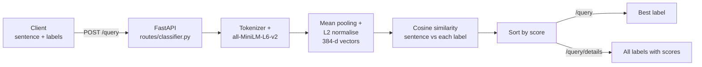
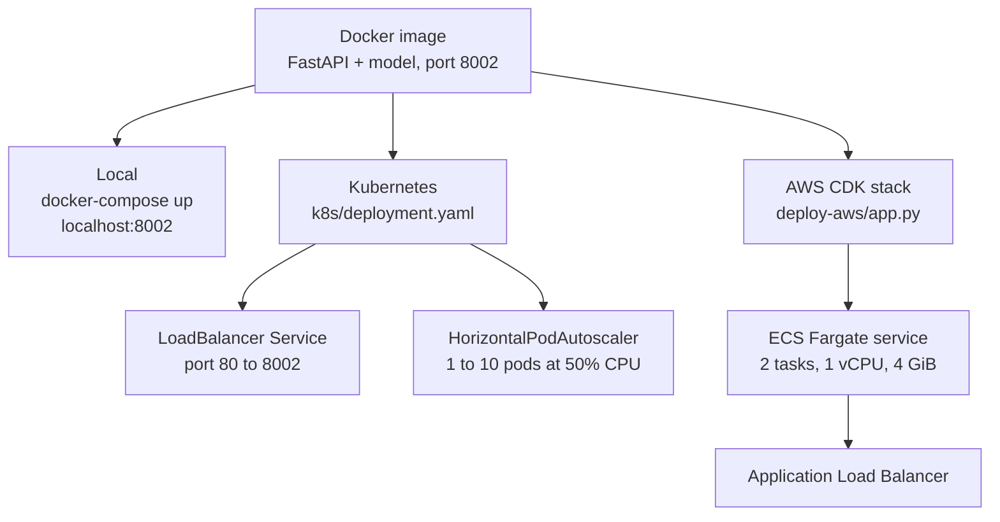

<p align="center"></p>

# Semantic Classification using Transformer and Deployment with FastAPI, Kubernetes, and AWS ECS Fargate + ALB

This project utilizes the all-MiniLM-L6-v2 model. This model maps sentences and paragraphs to a 384-dimensional dense vector space, making it suitable for tasks like clustering or semantic search. The project employs FastAPI to create an endpoint serving the transformer model.

## How it works

Zero-shot classification: no training step and no fixed label set. The sentence and every candidate label are embedded with the same model, and the label whose vector is closest to the sentence (highest cosine similarity) wins.



## Architecture

Client request -> FastAPI endpoint -> transformer classification -> JSON response. Docker Compose runs the API locally; Kubernetes and AWS ECS examples show deployment paths without relying on a public live endpoint.



Deployment note: Replace example endpoints and credentials with your own environment values before deploying.

## Usage

The model takes a sentence `S` to be classified, along with labels `L = {l1, l2, ...}`, and returns the most suitable label.

## Run locally

`docker-compose` is used to run locally.

### Start the API locally

```bash
docker-compose up
```

### Call the API

```bash
curl http://127.0.0.1:8002/query -X POST -H 'Content-Type: application/json' \
  -d '{"sentence": "feeling like a million bucks", "labels": ["happy", "sad", "rich"]}'
```

`/query` returns the best label:

```json
"rich"
```

`/query/details` returns every label with its cosine similarity, highest first (scores from `src/model`, rounded here):

```json
[["rich", 0.353], ["happy", 0.238], ["sad", 0.205]]
```

## Kubernetes deployment

    kubectl apply -f k8s/deployment.yaml

## Kubernetes Service

Creates a load balancer that exposes the service outside of the cluster.

    kubectl apply -f k8s/service.yaml

## HorizontalPodAutoscaler

To scale the deployment, apply a HorizontalPodAutoscaler.
Kubernetes will monitor the CPU usage of your pods, and if the CPU utilization exceeds the target average utilization, it will scale up the number of replicas.

    kubectl apply -f k8s/autoscale.yaml

A minikube run with ten `fast-mimilm` pods, each using about 150m CPU and 550 MiB:


## AWS ECS Fargate + ALB

The CDK stack in `deploy-aws/` runs the image on Fargate behind an Application Load Balancer. Steps: [deploy-aws/readme.md](deploy-aws/readme.md).


## Visual assets

The banner illustration was generated from a written brief (`docs/assets/briefs/hero.md`, with the references it drew on); its sidecar `docs/assets/hero-art.png.json` records the prompt. The text and scores are set by `docs/assets/tools/compose_banner.py`. `docs/assets/social-preview.jpg` (1280x640) is for the repository's social preview.
